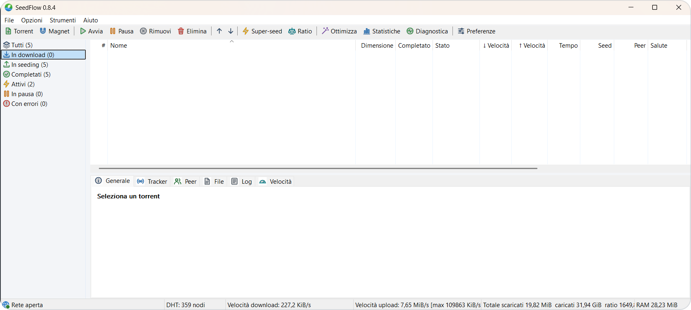

<div align="center">


**Client BitTorrent per Windows, scritto in C++ / Win32 e basato su libtorrent.**

[](https://github.com/Kyo89-sudo/SeedFlow/releases)
[](https://github.com/Kyo89-sudo/SeedFlow/releases/latest)
[](LICENSE)

[Release](https://github.com/Kyo89-sudo/SeedFlow/releases) · [Changelog](CHANGELOG.txt) · [Build](BUILDING.md) · [Issue tracker](https://github.com/Kyo89-sudo/SeedFlow/issues)

</div>

## Panoramica

SeedFlow è un client BitTorrent per Windows con interfaccia nativa Win32, basato su libtorrent 2.1. Scarica e condivide torrent e magnet, crea nuovi torrent nei formati v1, v2 e ibrido e offre strumenti di monitoraggio e diagnostica di rete.

La distribuzione è un **singolo eseguibile statico**: nessuna DLL da distribuire, nessun runtime .NET o Visual C++ da installare.

> **Ultima release:** [SeedFlow 0.8.7.3](https://github.com/Kyo89-sudo/SeedFlow/releases/tag/v0.8.7.3) — tab Grafico, nuove icone, scelta della cartella e spostamento dei file, Preferenze più compatte e guida integrata.

## Funzionalità

| Area | Dettagli |
| :--- | :--- |
| Download | File .torrent e magnet link con scelta della cartella e cartelle recenti, selezione e priorità dei singoli file, spostamento dei file in un'altra cartella, copia del magnet |
| Creazione torrent | Formati ibrido v1+v2, v1 e v2 da file o cartella; tracker per livello, web seed, commento, flag privato, dimensione dei pezzi automatica o manuale; hashing in background e seeding immediato |
| Code e banda | Coda automatica, limiti globali e per torrent, numero di connessioni e slot di upload |
| Seeding | Obiettivi di ratio con azioni automatiche (pausa, super-seeding, rimozione) e super-seeding per la distribuzione iniziale |
| Rete | IPv4/IPv6, UPnP e NAT-PMP, cifratura del protocollo configurabile, tracker HTTP/UDP, DHT, PeX e Local Peer Discovery |
| Affidabilità | Fast resume, scrittura atomica dello stato su disco, verifica forzata dei file |
| Monitoraggio | Peer, tracker, salute dello swarm, statistiche globali e tab Grafico (da 1 minuto a 2 ore, totale o per torrent) |
| Integrazione | Area di notifica, avvio con Windows, verifica della porta, porta casuale a ogni avvio e diagnostica di rete |

## Screenshot

<p align="center">
<a href="docs/seedflow-0.8.4-main-window.png"></a>
</p>

*Fai clic sull'immagine per lo screenshot a piena risoluzione.*

## Installazione

Requisiti: **Windows 10 o 11 a 64 bit**.

1. Scarica `SeedFlow-<versione>-win64-static.zip` dalla [pagina delle release](https://github.com/Kyo89-sudo/SeedFlow/releases) e verifica l'archivio con il relativo file `.sha256`.
2. Estrai l'archivio e avvia `SeedFlow.exe`.

Per aggiornare, chiudi la versione in uso con **File → Esci**, anche se è ridotta nell'area di notifica, e sostituisci l'eseguibile. Torrent e impostazioni restano in `%LOCALAPPDATA%\SeedFlow\State`.

## Compilazione

Requisiti: Visual Studio 2026 o 2022 con MSVC x64 e Windows SDK, CMake (4.2 o successivo con VS 2026) e Git.

```bat
build.bat -NoPause -RunTests
```

La build predefinita usa il triplet vcpkg `x64-windows-static` e il runtime `/MT`; la prima esecuzione compila anche le dipendenze. Opzioni e configurazione CMake manuale sono descritte in [BUILDING.md](BUILDING.md).

## Qualità

Ogni versione viene compilata con MSVC e verificate con la suite CTest, che comprende la regressione Win32 e il test isolato del motore. Le parti critiche (motore, creazione dei torrent, persistenza) sono inoltre analizzate con clang static analyzer, AddressSanitizer e UndefinedBehaviorSanitizer. Metodo, risultati e limiti di ciascuna versione sono documentati in [VERIFICA.txt](VERIFICA.txt).

## Licenza

**GNU GPL v3** (`GPL-3.0-only`): [LICENSE](LICENSE). I componenti di terze parti mantengono le [rispettive licenze](licenses/README.md).

## Segnalazioni

Apri una [issue](https://github.com/Kyo89-sudo/SeedFlow/issues) indicando la versione di SeedFlow e di Windows, i passaggi per riprodurre il problema, il risultato atteso e quello ottenuto. Prima di allegare log o screenshot, rimuovi dati personali, indirizzi IP e tracker privati.
