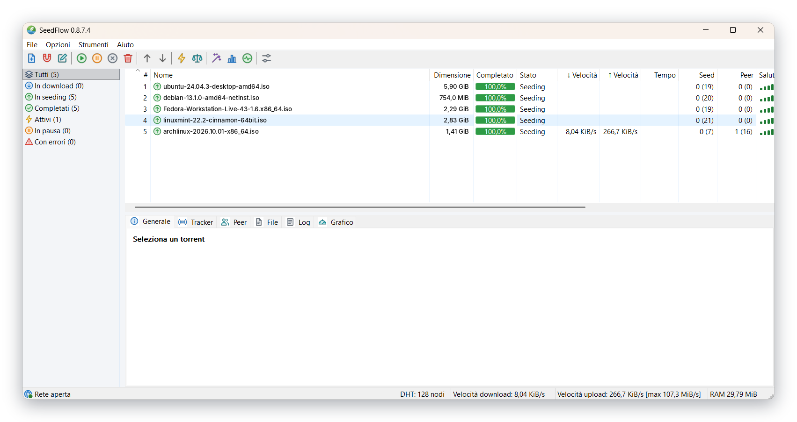

<div align="center">


### Download, seeding e creazione torrent in una finestra Windows nativa.

SeedFlow è un client BitTorrent per Windows basato su libtorrent 2.1 e C++20. L’interfaccia Win32 raccoglie in un unico posto torrent, magnet, peer, tracker e statistiche.

[](https://github.com/Kyo89-sudo/SeedFlow/releases/latest)
[](https://github.com/Kyo89-sudo/SeedFlow/releases/latest)
[](LICENSE)

[Funzionalità](#cosa-puoi-fare) · [Installazione](#installazione) · [Compilazione](#compilazione) · [Changelog](CHANGELOG.txt) · [Segnalazioni](https://github.com/Kyo89-sudo/SeedFlow/issues)

</div>

SeedFlow viene distribuito come **un solo eseguibile statico**: non servono DLL esterne né runtime .NET o Visual C++ da installare.

## Cosa puoi fare

- **Scaricare e condividere:** apri file `.torrent` o magnet, scegli la cartella, imposta priorità ai file e segui download e seeding.
- **Creare torrent:** genera metadati v1, v2 o ibridi da file e cartelle; aggiungi tracker, web seed e commenti.
- **Gestire la rete:** controlla peer e tracker, usa DHT, PeX, IPv4/IPv6, UPnP e NAT-PMP.
- **Tenere sotto controllo l’attività:** consulta velocità, statistiche, salute dei torrent e grafici globali o per torrent.
- **Gestire il seeding:** imposta obiettivi di ratio, usa il super-seeding e organizza i torrent con code e limiti di banda.

## Una schermata

<p align="center">
<a href="docs/seedflow-main-window.png"></a>
</p>

## Installazione

Serve Windows 10 o 11 a 64 bit.

1. Scarica l’ultima versione dalla [pagina delle release](https://github.com/Kyo89-sudo/SeedFlow/releases/latest).
2. Estrai `SeedFlow-<versione>-win64-static.zip` e avvia `SeedFlow.exe`.
3. Facoltativo: verifica lo ZIP con il file `.sha256` incluso tra gli allegati della release.

Per aggiornare, chiudi SeedFlow e sostituisci l’eseguibile. Torrent e impostazioni restano in `%LOCALAPPDATA%\SeedFlow\State`.

## Compilazione

Sono richiesti Visual Studio 2026 o 2022 con MSVC x64 e Windows SDK, CMake 4.2 o successivo con VS 2026, e Git. Il progetto usa C++20.

```bat
build.bat -NoPause -RunTests
```

La configurazione predefinita produce un eseguibile statico x64 con runtime `/MT`. La prima compilazione prepara anche le dipendenze e può richiedere tempo. Opzioni e configurazione CMake sono descritte in [BUILDING.md](BUILDING.md).

## Verifiche

La build 0.8.8 è stata compilata con Visual Studio 2026 e ha superato entrambi i test CTest. [VERIFICA.txt](VERIFICA.txt) riporta copertura e verifiche non eseguite.

## Licenza

SeedFlow è distribuito secondo **GNU GPL v3** (`GPL-3.0-only`): [testo della licenza](LICENSE). Le dipendenze mantengono le [proprie licenze](licenses/README.md).

## Segnalazioni

Per segnalare un problema, apri una [issue](https://github.com/Kyo89-sudo/SeedFlow/issues) con versione del programma e di Windows, passaggi per riprodurlo e risultato atteso. Prima di allegare log o screenshot, rimuovi dati personali, indirizzi IP e tracker privati.
